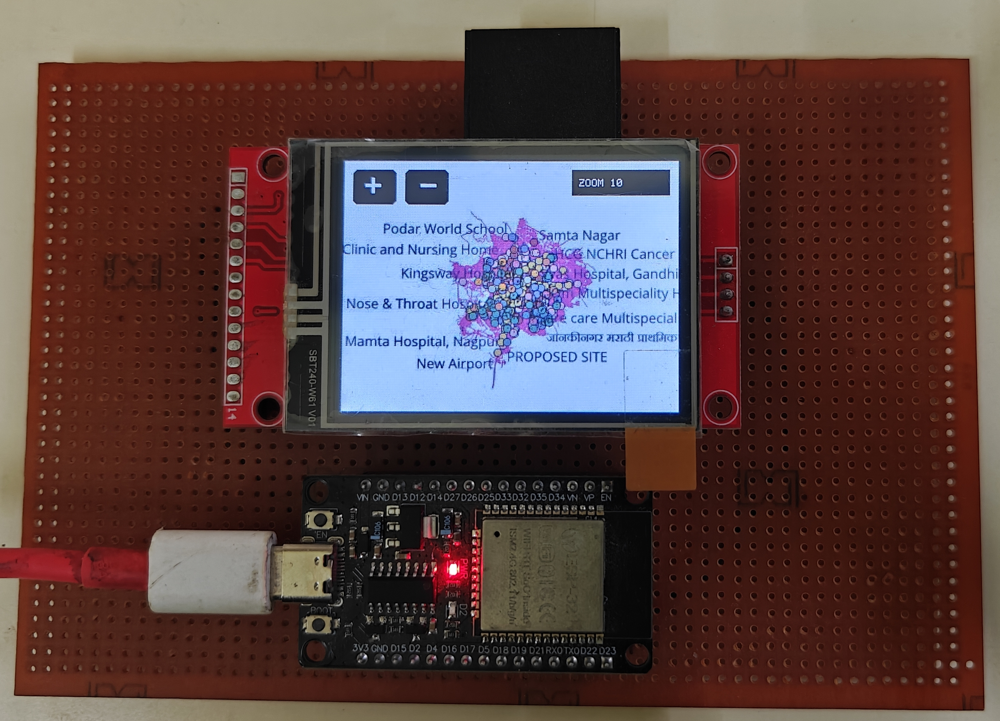
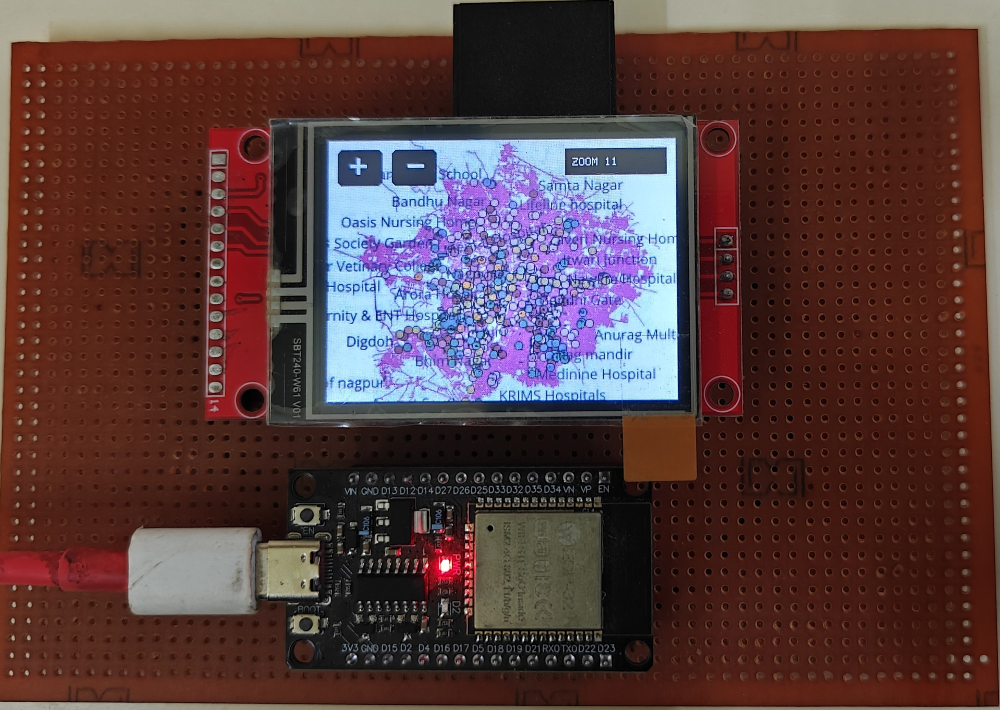
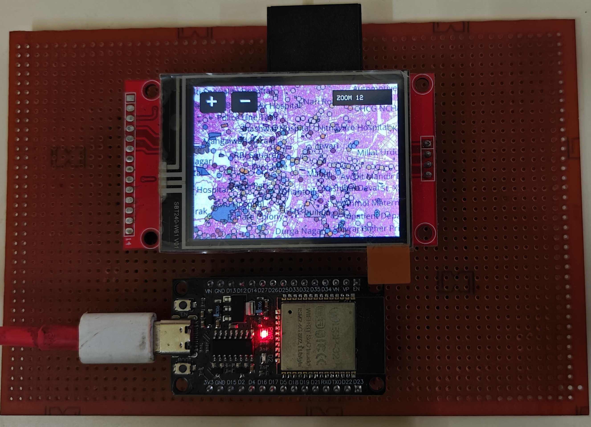
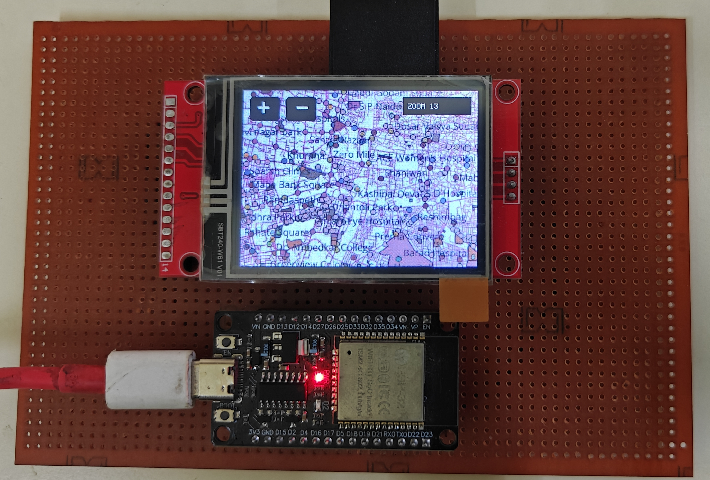
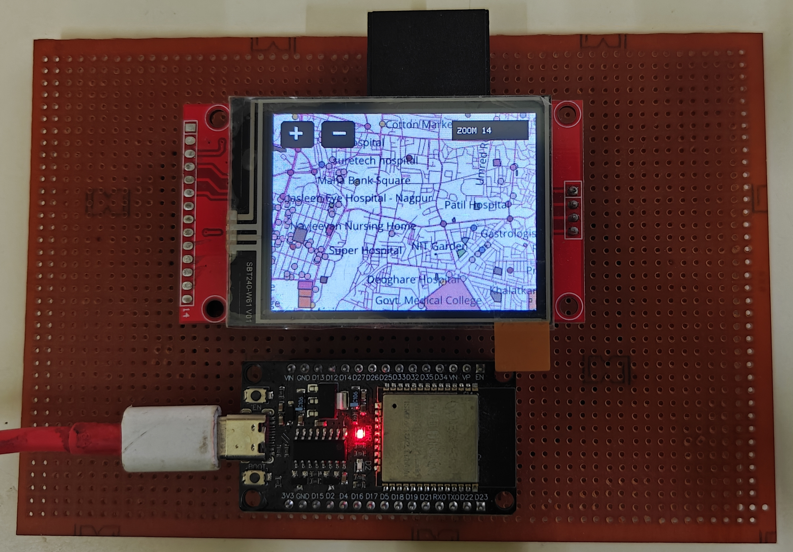
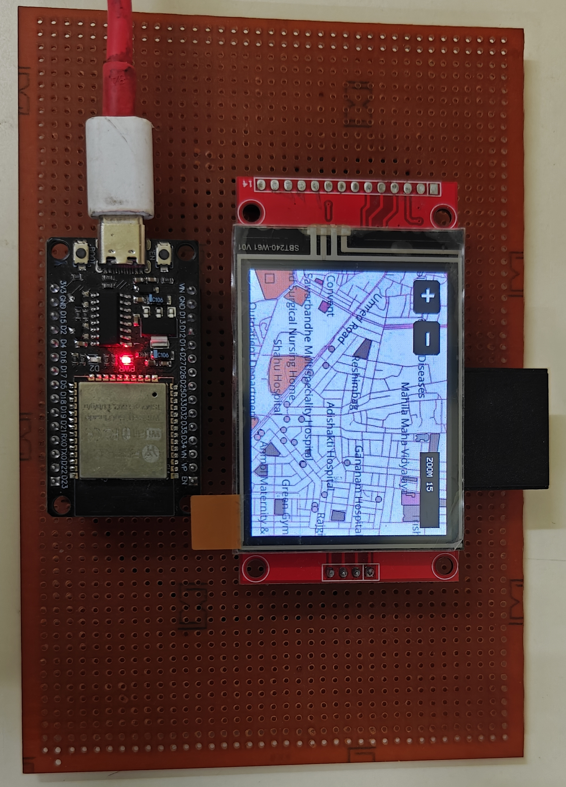

# 🗺️ Offline OSM Map Viewer using ESP32

An embedded mapping project that displays an **offline map of Nagpur, Maharashtra, India**, on a 2.4-inch TFT touchscreen using an ESP32 development board. The map tiles are stored on a microSD card, allowing the map to be viewed without an active internet connection.

The project uses map data from **OpenStreetMap (OSM)**, processed using QGIS and exported as image tiles for offline use.

---

## ✨ Features

- 🗺️ Offline map viewing of Nagpur.
- 🔍 Multiple zoom levels (10–15).
- 👆 Touchscreen-based map panning.
- 💾 Map tiles stored locally on a microSD card.
- 🖥️ Compact display using a 2.4-inch ST7789 TFT.
- 🔌 Built using an ESP32 development board.

---

## 🧰 Hardware Requirements

|Sr no.| Component | Description |
|---|---|---|
|1. | ESP32 DevKit V1 | Main microcontroller |
|2. | 2.4-inch ST7789 TFT | 320 × 240 colour display |
|3. | XPT2046 Touch Controller | Resistive touchscreen input |
|4. | microSD-to-SD adapter | lets you fit small sd card into bigger slot |
|5. | microSD card (8GB) | Contains the exported map images |
|6. | Female pin headers x2 | To place components |
|7. | Perfboard | Prototyping board |

*Note: The touchscreen controller and microSD interface may be integrated into your display module or connected separately.*

---

## 📸 Hardware photos

| Zoom level 10 | Zoom level 11 |
|:---: | :---: |
|  |  |
| Zoom level 12 | Zoom level 13 |
|:---: | :---: |
|  |  |
| Zoom level 14 | Zoom level 15 |
|:---: | :---: |
|  |  |

---

## 💻 Software and Tools

- **Arduino IDE** — firmware development and uploading.
- **Arduino ESP32 Core** — ESP32 board support.
- **QGIS** — processing geographic data and generating map tiles.
- **OpenStreetMap** — geographic map data.
- **Adafruit GFX and Adafruit ST7789** — display graphics and TFT control.
- **XPT2046_Touchscreen** — touchscreen input.
- **TJpg_Decoder** — JPEG tile decoding.
- **SD and SPI libraries** — microSD storage and communication.

---

## ⚙️ How It Works

1. OpenStreetMap geographic data is processed and styled in QGIS.
2. The map is exported as 256 × 256 JPEG tiles at zoom levels 10–15.
3. The exported tiles are copied to the microSD card.
4. The ESP32 reads the required tiles and decodes them for display.
5. Touch input allows the user to pan around the map and change zoom levels.

---

## 🚀 Setup

1. Install the Arduino IDE and ESP32 board support.
2. Install the required Arduino libraries listed above.
3. Copy the exported map tiles to the microSD card, preserving the expected directory structure.
4. Connect the TFT, touchscreen and SD card according to the pin table.
5. Open the project's `.ino` file in Arduino IDE.
6. Select the appropriate ESP32 board and COM port, then upload the firmware.
7. Insert the microSD card and power on the device.

**Important:** The firmware's expected folder paths and tile naming conventions must match the structure of the map files on the microSD card.

---

## 🔮 Future Improvements

- 🔎 Search for places, streets and landmarks.
- 📍 Select a destination directly on the map.
- 🛣️ Calculate routes and road distances between locations.
- 🏥 Display points of interest, such as hospitals, schools and parks.
- ⚡ Improve map caching and rendering for smoother panning.
- 🧭 Add GPS-based location tracking.
- 🔋 Optimise power consumption for portable use.

---

## 🙌 Credits

- [OpenStreetMap](https://www.openstreetmap.org/) — geographic data.
- [QGIS](https://qgis.org/) — geographic data processing and map rendering.

Map data © OpenStreetMap contributors. OpenStreetMap data is available under the [Open Database License (ODbL)](https://www.openstreetmap.org/copyright).

---

**Project Status:** Work in progress 🚧

Built as an exploration of embedded systems, geographic information systems (GIS), and offline mapping using ESP32.

---

## 📄 License

This project is licensed under the MIT License — see the [LICENSE](LICENSE) file for details.

## 👤 Author

**Soham Kale**
GitHub: [@SohamKale83](https://github.com/SohamKale83)